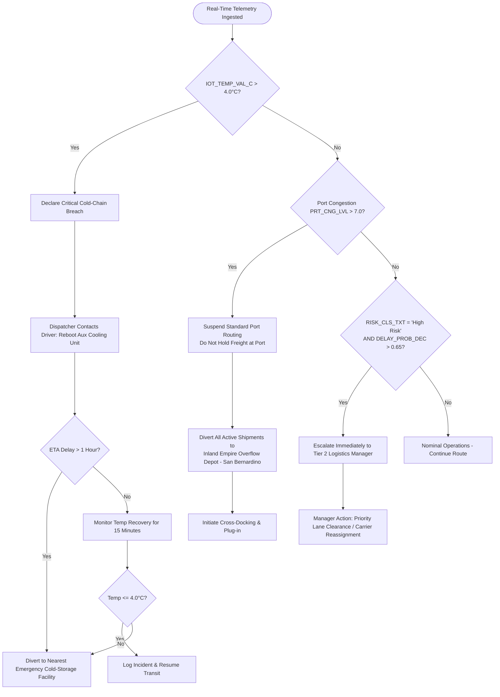

# Southern California Logistics Operations

## Standard Operating Procedure (SOP): Cold-Chain Integrity & Transit Anomaly Response
**Document ID:** SOP-OPS-SOCAL-2021-02  
**Version:** 2.4 | **Effective Date:** January 15, 2021 | **Review Cycle:** Annual  
**Classification:** Internal Operations Only | **Compliance Standards:** FDA FSMA (21 CFR Part 1 Subpart O) / Good Distribution Practice (GDP)

---

### 1. Document Control & Administration

| Attribute | Specification |
| :--- | :--- |
| **Document Title** | Standard Operating Procedure: Cold-Chain Integrity & Transit Anomaly Response |
| **SOP Owner** | Director of Supply Chain Logistics & Fleet Safety |
| **Operational Corridor** | Southern California Region (Port of Los Angeles, Port of Long Beach, Inland Empire, San Bernardino Transit Corridor) |
| **Target Assets** | Refrigerated Fleets (Reefers), Intermodal Cold Containers, IoT Telemetry Units |
| **Telemetry Source** | Enterprise Fleet Database (`dbo.TBL_SC_FLEET_HIST_RAW`) |
| **Last Reviewed** | January 2021 |
| **Approved By** | VP of Fleet Logistics Operations & Head of Quality Assurance |

---

### 2. Purpose & Objectives
The purpose of this Standard Operating Procedure (SOP) is to establish deterministic, standardized response workflows for cold-chain excursions, maritime port bottlenecks, and transit risk anomalies within the Southern California logistics grid. 

**Core Objectives:**
1. **Prevent Cargo Spoilage:** Maintain temperature integrity across perishable freight to ensure zero product loss.
2. **Mitigate SLA Penalties:** Enforce immediate route diversion protocols during severe port congestion events.
3. **Automate Escalation:** Ensure timely human-in-the-loop intervention for composite high-risk transit shipments.
4. **Regulatory Compliance:** Maintain full compliance with the FDA Food Safety Modernization Act (FSMA) Sanitary Transportation Rule.

---

### 3. Scope & System Data Dictionary

This procedure applies to all Tier 1 Dispatchers, Tier 2 Logistics Operations Managers, Fleet Drivers, and Logistics Platform Systems monitoring real-time telemetry from `dbo.TBL_SC_FLEET_HIST_RAW`.

#### Telemetry Field Cross-Reference
| Field Name in DB | Field Description | Unit / Scale | Nominal Operating Range | Anomaly Threshold |
| :--- | :--- | :--- | :--- | :--- |
| `TS_UTC` | Telemetry Timestamp | ISO 8601 (UTC) | Real-time ($\le$ 5 min latency) | Latency > 15 minutes |
| `V_LAT` / `V_LON` | Vehicle GPS Coordinates | Decimal Degrees | SoCal Grid ($32^\circ\text{N} - 35^\circ\text{N}$, $-116^\circ - -119^\circ$) | Route deviation > 15 miles |
| `IOT_TEMP_VAL_C` | Cargo Compartment Temperature | Celsius (°C) | **0.0°C to 4.0°C** (Fresh Perishables) | **> 4.0°C** (Critical Breach) |
| `CGO_COND_CD` | Cargo Condition Status | Normalized Index | 0.80 – 1.00 (Optimal) | < 0.60 (Degraded) |
| `PRT_CNG_LVL` | Port Congestion Severity Index | Index (0.0 – 10.0) | 0.0 – 6.9 (Normal to Elevated) | **> 7.0** (Severe Congestion) |
| `RT_RSK_IDX` | Route Risk Index | Index (0.0 – 10.0) | 0.0 – 5.0 (Low to Medium) | > 7.5 (High Risk Corridor) |
| `DELAY_PROB_DEC` | Predicted Delay Probability | Probability (0.00 – 1.00) | 0.00 – 0.49 (On Schedule) | **> 0.65** (Critical Delay Risk) |
| `RISK_CLS_TXT` | Shipment Risk Classification | String (`Low`, `Moderate`, `High`) | `Low Risk`, `Moderate Risk` | **`High Risk`** |

---

### 4. Roles & Responsibilities (RACI Matrix)

* **R (Responsible):** The role executing the operational task.
* **A (Accountable):** The individual with final sign-off and operational ownership.
* **C (Consulted):** Subject matter expert providing inputs.
* **I (Informed):** Stakeholders notified of status updates.

| Operational Task | Tier 1 Dispatcher | Fleet Driver | Tier 2 Logistics Manager | Cold Storage Depot Lead | QA Compliance Lead |
| :--- | :---: | :---: | :---: | :---: | :---: |
| IoT Temp Breach Detection & Initial Triage | **R / A** | **I** | **I** | — | — |
| Auxiliary Cooling Unit Restart | **I** | **R / A** | — | — | — |
| Emergency Cold-Storage Facility Diversion | **R** | **R** | **A** | **C** | **I** |
| Port Long Beach/LA Congestion Diversion | **R** | **R** | **A** | **C** | **I** |
| High-Risk Composite Escalation Management | **C** | **I** | **R / A** | — | **I** |
| Post-Incident CCIR & QA Disposition | **C** | **I** | **C** | **I** | **R / A** |

---

### 5. Standard Operating Procedures & Protocols

---

#### 5.1 Protocol A: Temperature Control & Spoilage Prevention (Cold-Chain)

##### Operating Policy
Refrigerated fleets carrying fresh perishables must maintain compartment temperature (`IOT_TEMP_VAL_C`) within the mandatory regulatory envelope of **0.0°C to 4.0°C**.

##### Threshold Definitions
* **Nominal Range:** $0.0^\circ\text{C} \le \text{IOT\_TEMP\_VAL\_C} \le 4.0^\circ\text{C}$
* **Warning Band:** $3.0^\circ\text{C} < \text{IOT\_TEMP\_VAL\_C} \le 4.0^\circ\text{C}$ (Trigger proactive system advisory)
* **Critical Breach:** $\text{IOT\_TEMP\_VAL\_C} > \mathbf{4.0^\circ C}$ (Immediate Cold-Chain Incident declared)

##### Step-by-Step Mitigation Protocol
1. **Breach Declaration:**
   * Upon detecting `IOT_TEMP_VAL_C` $> 4.0^\circ\text{C}$ sustained over 2 consecutive telemetry pings ($\ge 5$ minutes), Tier 1 Dispatcher declares an immediate Cold-Chain Breach.
2. **Driver Contact & Reefer Auxiliary Unit Restart:**
   * The dispatcher must contact the driver via direct radio/cab cellular dispatch within **5 minutes**.
   * Instruct driver to perform an immediate manual restart of the auxiliary refrigeration cooling unit (APU/reefer generator).
   * Confirm reefer fuel supply is above 25% capacity and airflow vents are unblocked.
3. **Transit Delay & ETA Evaluation:**
   * Dispatcher evaluates vehicle ETA delay using `eta_variation_hours` and route delay estimates.
   * **If ETA delay is greater than 1 hour (> 1.0 hr):**
     * **Execute Immediate Diversion:** Do not attempt further on-road cooling stabilization.
     * Divert the vehicle immediately to the nearest certified emergency cold-storage facility (refer to Section 7 for facility directory).
   * **If ETA delay is less than or equal to 1 hour ($\le 1.0$ hr):**
     * Monitor temperature decay curve every 5 minutes.
     * If temperature fails to return to $\le 4.0^\circ\text{C}$ within 15 minutes of auxiliary restart, execute mandatory diversion.
4. **Cargo Disposition on Arrival:**
   * Facility warehouse manager logs `CGO_COND_CD` and performs physical core-temperature probe testing.
   * Freight is quarantined pending QA release if compartment temperature exceeded $4.0^\circ\text{C}$ for greater than 45 continuous minutes.

---

#### 5.2 Protocol B: Port Congestion & Diversion Tactics

##### Operating Policy
Terminal and gate congestion at maritime container terminals severely impacts turn times, driver hours-of-service (HOS), and cold-chain integrity. Standard routing into container terminals must be actively suspended during congestion spikes.

##### Threshold Definitions
* **Nominal Port Operation:** $\text{PRT\_CNG\_LVL} \le 7.0$
* **Severe Congestion Trigger:** $\text{PRT\_CNG\_LVL} > \mathbf{7.0}$ (Suspension of Standard Port Routing)

##### Target Corridors
* Port of Long Beach (POLB) Container Terminals
* Port of Los Angeles (POLA) Container Terminals

##### Step-by-Step Mitigation Protocol
1. **Standard Routing Suspension:**
   * When `PRT_CNG_LVL` exceeds the severity index threshold of **7.0**, standard dispatch routing into Port of Long Beach and Port of LA is suspended immediately.
2. **Anti-Holding Rule:**
   * **Under no circumstances shall freight be held idling at port gates or container holding yards.** Extended gate idling leads to auxiliary unit fuel depletion and elevated breach risk.
3. **Mandatory Diversion Execution:**
   * Divert all active incoming shipments immediately to the designated regional inland contingency hub:
     * **Primary Diversion Facility:** **Inland Empire Overflow Depot (San Bernardino)**
     * **Purpose:** Rapid cross-docking, consolidation, and auxiliary electrical shore power (plug-in) hookup.
4. **Cross-Docking & Holding Workflow:**
   * Transmit electronic advance shipment notice (e-ASN) to San Bernardino Depot Operations.
   * San Bernardino team allocates an available electric reefer plug bay upon arrival.
   * Hold cargo in controlled cross-dock staging until Port Congestion Index returns to acceptable levels ($\text{PRT\_CNG\_LVL} \le 5.5$).

---

#### 5.3 Protocol C: Composite Risk Classification & Tier 2 Escalation

##### Operating Policy
High-risk shipments with high statistical probability of delay represent disproportionate financial liability and customer breach risk. These scenarios require executive-level operations management.

##### Threshold Trigger Condition
A shipment must be immediately escalated when **both** of the following conditions are simultaneously met:
$$\mathbf{RISK\_CLS\_TXT = "High\ Risk"} \quad \mathbf{\&} \quad \mathbf{DELAY\_PROB\_DEC > 0.65}$$

##### Step-by-Step Mitigation Protocol
1. **Tier 1 Automated Flagging & Notification:**
   * System or Tier 1 Dispatcher flags the shipment record in the monitoring dashboard.
   * Issue high-priority alert to the **Tier 2 Logistics Operations Manager** within **10 minutes** of threshold trigger.
2. **Tier 2 Management Intervention:**
   * Tier 2 Manager conducts an immediate operational review of the active transit segment:
     * Review real-time vehicle coordinates (`V_LAT`, `V_LON`) and route risk index (`RT_RSK_IDX`).
     * Evaluate carrier capacity for team-driver swap or dynamic relay dispatch.
     * Order high-occupancy toll (HOT) or priority bypass lane authorization if available on Interstate corridors (I-10 / I-15 / I-710).
3. **Customer & Stakeholder Advisory:**
   * Customer account manager notifies the end consignee of estimated variance if projected delay exceeds SLA grace window (30 minutes).
   * Record action plan in Enterprise Logistics Management System (ELMS).

---

### 6. Incident Documentation, Quality Assurance & Audit Trail

1. **Cold-Chain Incident Report (CCIR):**
   * A digital CCIR must be created within **12 hours** of any Section 5.1 temperature breach or Section 5.3 escalation.
   * Required CCIR Data Fields:
     * Shipment ID / Manifest Number
     * Vehicle ID, Driver Name, and Carrier Partner
     * Initial Incident Timestamp (`TS_UTC`) and Duration of Anomaly
     * Peak Temperature Recorded (`IOT_TEMP_VAL_C`)
     * Final Cargo Condition Status (`CGO_COND_CD`)
     * Corrective Actions Executed (Auxiliary restart, diversion facility, Tier 2 approval)
2. **Compliance Log Retention:**
   * In compliance with FDA FSMA Title 21 CFR § 1.912, all digital telemetry records, sensor logs, and mitigation notes must be retained in immutable storage for a minimum of **24 months**.
3. **Root Cause Analysis (RCA):**
   * Operations Engineering must perform an RCA within **72 hours** for recurring equipment failures or preventable transit diversions.

---

### 7. Emergency Contact & Facility Directory

#### 7.1 Key Operational Desks
| Role / Desk | Contact Channel | Availability | Escalation Response SLA |
| :--- | :--- | :--- | :--- |
| **Tier 1 Dispatch Operations Desk** | Ops Radio Ch. 4 / ext. 4101 | 24/7/365 | Immediate (< 5 min) |
| **Tier 2 Duty Logistics Manager** | On-Call Mobile / Ops Pager 901 | 24/7/365 | $\le$ 10 minutes |
| **Fleet Maintenance & APU Emergency Support** | Hot-Line: 1-800-555-COLD | 24/7/365 | $\le$ 15 minutes |
| **Cold-Chain QA Compliance Officer** | Email: `compliance-qa@socal-logistics.internal` | 06:00 – 22:00 PST | $\le$ 2 hours |

#### 7.2 Contingency Facilities & Cold-Storage Depots
| Facility Name | Location / GPS | Primary Function | Reefer Plug Bays |
| :--- | :--- | :--- | :--- |
| **Inland Empire Overflow Depot** *(Primary Diversion)* | **San Bernardino, CA** ($34.1083^\circ\text{N}, -117.2898^\circ\text{W}$) | Port Congestion Cross-Dock / Cold Staging | 48 bays (480V 30A) |
| **Ontario Cold-Storage Logistics Center** | Ontario, CA ($34.0633^\circ\text{N}, -117.6509^\circ\text{W}$) | Emergency Perishables Staging | 32 bays |
| **Long Beach Contingency Transfer Yard** | Long Beach, CA ($33.7701^\circ\text{N}, -118.1937^\circ\text{W}$) | Intermodal Pre-Gate Staging | 20 bays |
| **South Bay Refrigerated Logistics Hub** | Carson, CA ($33.8317^\circ\text{N}, -118.2817^\circ\text{W}$) | Secondary Cold-Chain Quarantine | 24 bays |